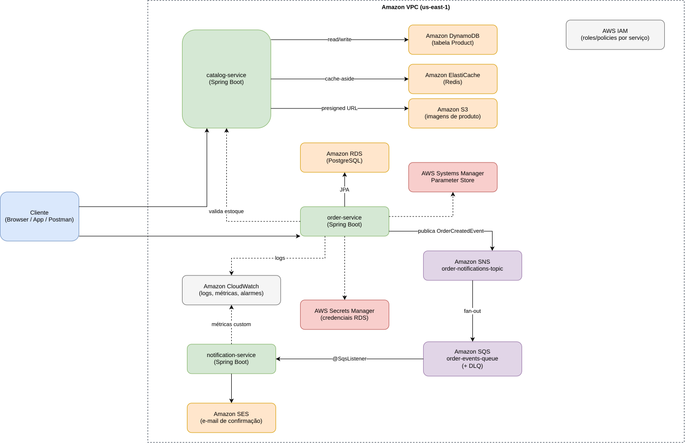
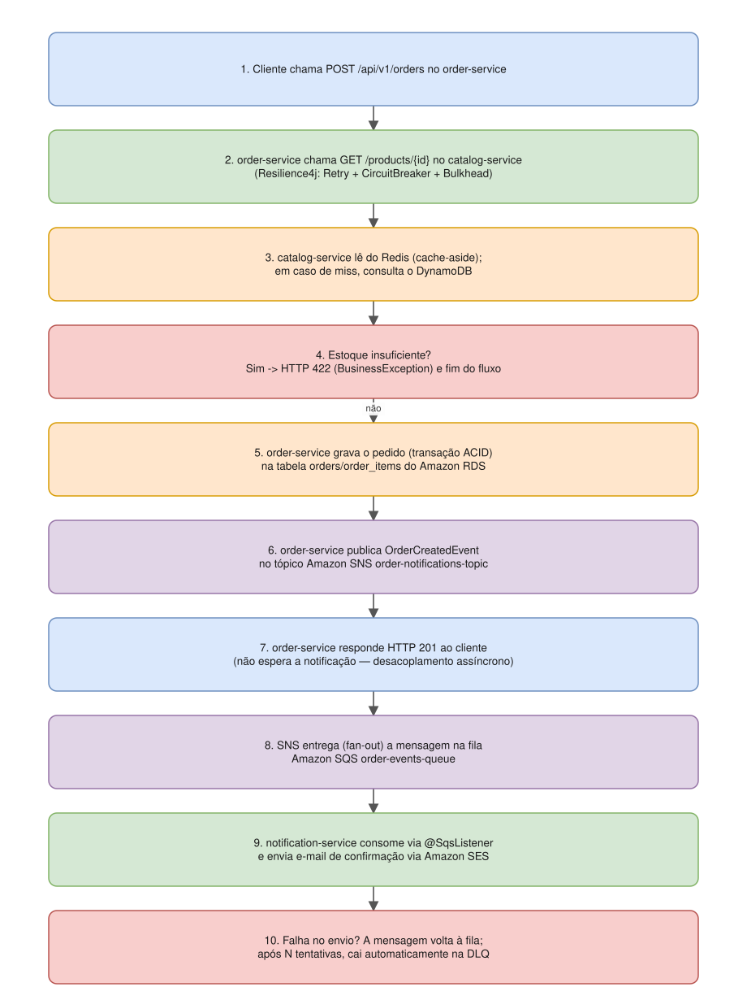
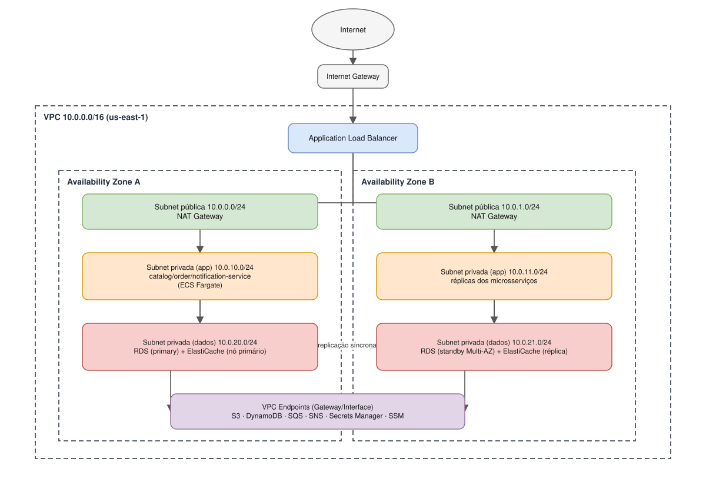

# E-commerce AWS + Spring Cloud AWS — estudo para o AWS Certified Solutions Architect – Associate

Projeto de estudo prático para a certificação **AWS Certified Solutions
Architect – Associate (SAA-C03)**: um e-commerce cloud native, dividido em
três microsserviços Spring Boot, que consome os principais serviços AWS
através do **Spring Cloud AWS**, com resiliência via **Resilience4j** e um
ebook completo explicando cada decisão.

Não é preciso instalar Java, Maven ou AWS CLI — **apenas Docker**:

```bash
docker compose up --build
```

| Serviço | Swagger UI | Serviços AWS |
|---|---|---|
| `catalog-service` | http://localhost:8081/swagger-ui.html | DynamoDB, S3, ElastiCache (Redis) |
| `order-service` | http://localhost:8082/swagger-ui.html | RDS (PostgreSQL), Secrets Manager, Parameter Store, SNS |
| `notification-service` | http://localhost:8083/swagger-ui.html | SQS, SES, CloudWatch |

Todos os três usam **IAM** (conceitualmente), rodam dentro de uma **VPC**
(em produção) e aplicam **Resilience4j** (circuit breaker, retry,
bulkhead) nas chamadas entre si e com a AWS.

## 📖 Sumário do ebook

O ebook completo está em [`ebook/`](ebook/), em capítulos Markdown
navegáveis (cada um tem link para o anterior/próximo no rodapé). Comece pelo
capítulo 0:

0. [Introdução e como usar este ebook](ebook/00-introducao-e-como-usar.md)
1. [Fundamentos AWS e o AWS Well-Architected Framework](ebook/01-fundamentos-aws-well-architected.md)
2. [IAM, Segurança e Amazon Cognito](ebook/02-iam-seguranca-cognito.md)
3. [Redes: Amazon VPC](ebook/03-redes-vpc.md)
4. [Computação: EC2, ECS/Fargate e Lambda](ebook/04-computo-ec2-ecs-lambda.md)
5. [Armazenamento: Amazon S3](ebook/05-armazenamento-s3.md)
6. [Banco de Dados Relacional: Amazon RDS](ebook/06-banco-relacional-rds.md)
7. [Banco de Dados NoSQL: Amazon DynamoDB](ebook/07-banco-nosql-dynamodb.md)
8. [Cache: Amazon ElastiCache (Redis)](ebook/08-cache-elasticache.md)
9. [Mensageria: Amazon SQS e SNS](ebook/09-mensageria-sqs-sns.md)
10. [E-mail Transacional: Amazon SES](ebook/10-email-ses.md)
11. [Configuração e Segredos: Parameter Store e Secrets Manager](ebook/11-config-secrets-parameter-store.md)
12. [Observabilidade: Amazon CloudWatch](ebook/12-observabilidade-cloudwatch.md)
13. [Arquitetura da Solução (diagramas)](ebook/13-arquitetura-da-solucao.md)
14. [Cloud Native e Boas Práticas AWS](ebook/14-cloud-native-boas-praticas.md)
15. [Resiliência com Resilience4j](ebook/15-resiliencia-resilience4j.md)
16. [Custos, Billing e FinOps](ebook/16-custos-billing-finops.md)
17. [Guia de Uso e Swagger/OpenAPI](ebook/17-guia-de-uso-swagger.md)
18. [Referências Oficiais AWS](ebook/18-referencias.md)

## 🎯 Trilha SAA-C03: o que a prova cobra e o projeto não exercita

Os capítulos acima ensinam os serviços na prática. A trilha em
[`ebook/saa-c03/`](ebook/saa-c03/) completa o conteúdo da prova e organiza o
estudo para você chegar a ela com segurança. Comece pelo plano:

- [Plano de estudos](ebook/saa-c03/00-plano-de-estudos.md): formato da prova, pesos dos domínios, 5 fases e critério de prontidão
- [Mapa de cobertura](ebook/saa-c03/mapa-de-cobertura.md): o que o repositório cobre e o que vem da trilha
- [S1. ELB e Auto Scaling](ebook/saa-c03/01-elb-e-auto-scaling.md)
- [S2. Route 53, CloudFront e Global Accelerator](ebook/saa-c03/02-route53-cloudfront-global-accelerator.md)
- [S3. Segurança: KMS, WAF, detecção e governança](ebook/saa-c03/03-seguranca-kms-waf-governanca.md)
- [S4. Recuperação de desastres e backup](ebook/saa-c03/04-dr-e-backup.md)
- [S5. EBS, EFS, FSx e Storage Gateway](ebook/saa-c03/05-armazenamento-ebs-efs-fsx.md)
- [S6. Conectividade híbrida e rede avançada](ebook/saa-c03/06-conectividade-hibrida.md)
- [S7. Analytics, integração de aplicações e containers](ebook/saa-c03/07-analytics-integracao-containers.md)
- [S8. Migração, transferência de dados e custos](ebook/saa-c03/08-migracao-transferencia-e-custos.md)
- [Banco de questões de cenário](ebook/saa-c03/questoes-de-cenario.md)
- [Laboratórios no console AWS](ebook/saa-c03/labs.md)
- [Diário de erros](ebook/saa-c03/diario-de-erros.md)

## 🗺️ Diagramas

Em [`ebook/diagrams/`](ebook/diagrams/): cada diagrama tem um `.svg` (renderiza
direto aqui no GitHub, sem precisar de nenhuma ferramenta) e um `.drawio`
equivalente, para quem quiser editar visualmente em
[app.diagrams.net](https://app.diagrams.net).

**Arquitetura geral** — visão completa dos 3 serviços e dos serviços AWS
([editar .drawio](ebook/diagrams/01-arquitetura-geral.drawio)):



**Fluxo de criação de pedido** — passo a passo, do POST até a DLQ
([editar .drawio](ebook/diagrams/02-fluxo-criacao-pedido.drawio)):



**Rede VPC** — topologia de referência de subnets/AZs para produção
([editar .drawio](ebook/diagrams/03-rede-vpc.drawio)):



## 🏗️ Estrutura do repositório

```
.
├── docker-compose.yml          # infra local: LocalStack, Postgres, Redis + os 3 serviços
├── infra/localstack/init/      # provisiona bucket S3, tabela DynamoDB, filas/tópicos, segredos e parâmetros
├── services/
│   ├── common/                 # exceções, tratamento de erro e logging de resiliência compartilhados
│   ├── catalog-service/        # DynamoDB + S3 + Redis
│   ├── order-service/          # RDS + Secrets Manager + Parameter Store + SNS
│   └── notification-service/   # SQS + SES + CloudWatch
└── ebook/                      # este ebook, em Markdown, + diagramas draw.io
    └── saa-c03/                # trilha de estudo: plano, capítulos S1-S8, questões, labs, diário de erros
```

## 🚀 Quickstart

```bash
git clone https://github.com/camarguinho/aws-learning.git
cd aws-learning
docker compose up --build
```

Depois, siga o [Capítulo 17 — Guia de Uso e Swagger](ebook/17-guia-de-uso-swagger.md)
para um passo a passo completo do fluxo de ponta a ponta (criar produto →
criar pedido → ver notificação → testar resiliência).

## 🧪 Rodando os testes

```bash
docker run --rm -v "$PWD":/workspace -w /workspace maven:3.9-eclipse-temurin-21 mvn test
```

(ou, se você já tem Maven/Java localmente, simplesmente `mvn test` na raiz.)

## Licença

[MIT](LICENSE)
